# Preview

What the app looks like on a phone. The website has its own tour in the
backend repo's [`PREVIEW.md`](https://github.com/vovafes/water-app/blob/main/PREVIEW.md).

Screenshots below are from the **Android** build (Pixel 10 emulator,
Android API 37, 1080×2424), English locale, logged in as the seeded demo
account against a local backend. Light theme first, then dark.

**iOS is not shown here.** The iOS simulator only runs on macOS, and these
shots were taken on Windows. The screens are one Flutter codebase, so the
layouts are the same on iPhone. What differs is system chrome: the status
bar and home indicator, the back-swipe gesture, and the launch screen
(white droplet on brand blue, see `ios/Runner/Base.lproj/LaunchScreen.storyboard`).
To add iPhone shots, run the app in the simulator on the Mac and drop the
PNGs into `docs/preview/ios/`.

---

## Sign in

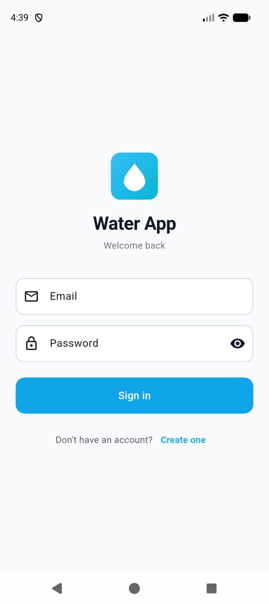

## Home

Today's progress at the top, then every drink as one tap. Tapping the
streak chip opens the streak calendar.

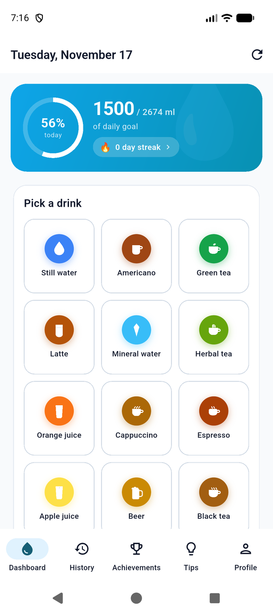 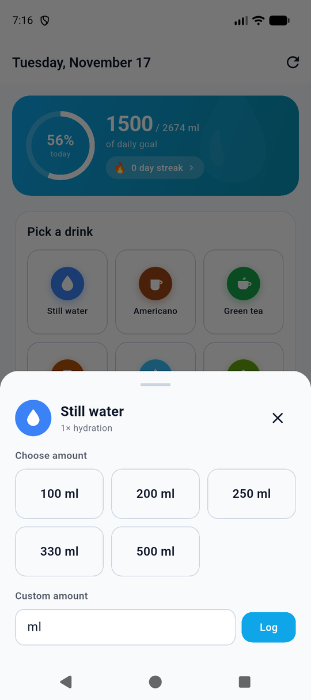 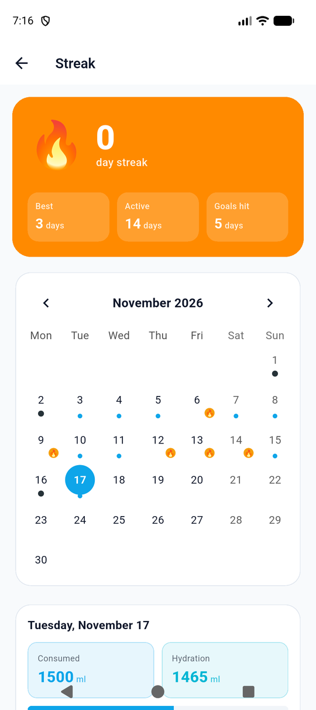

## History, achievements, tips

Swipe an entry left in History to delete it (it asks first).

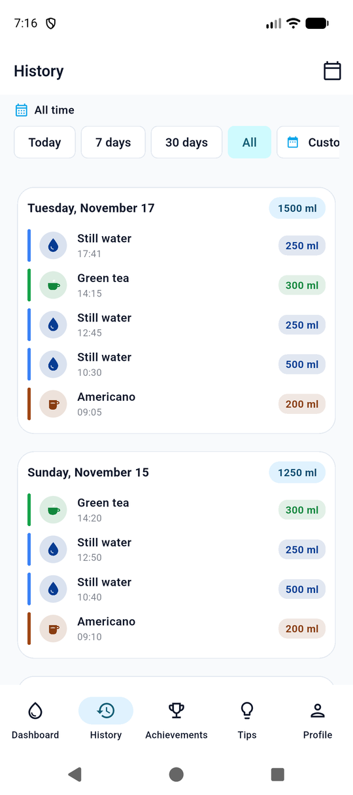 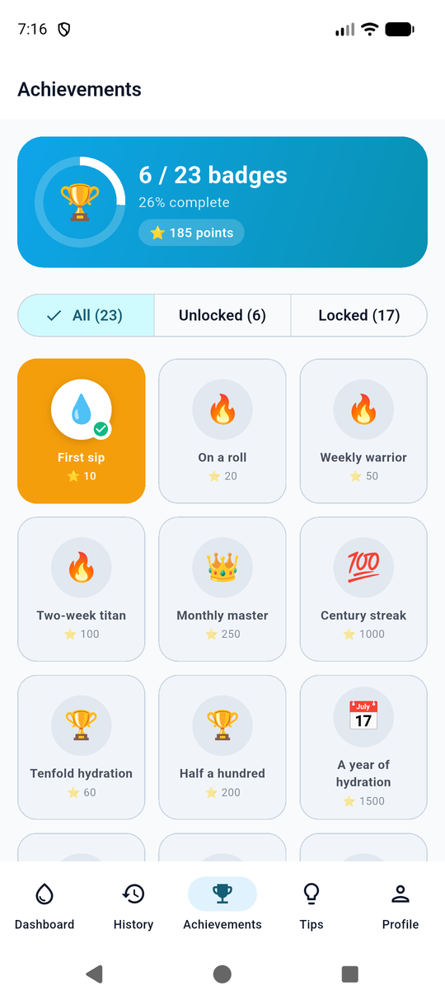 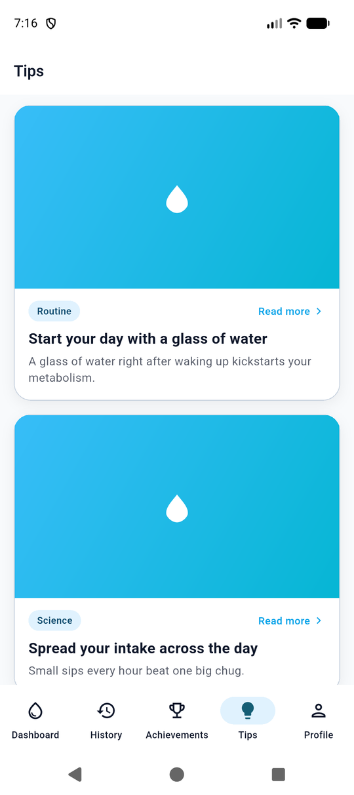

## Profile, Premium, reminders

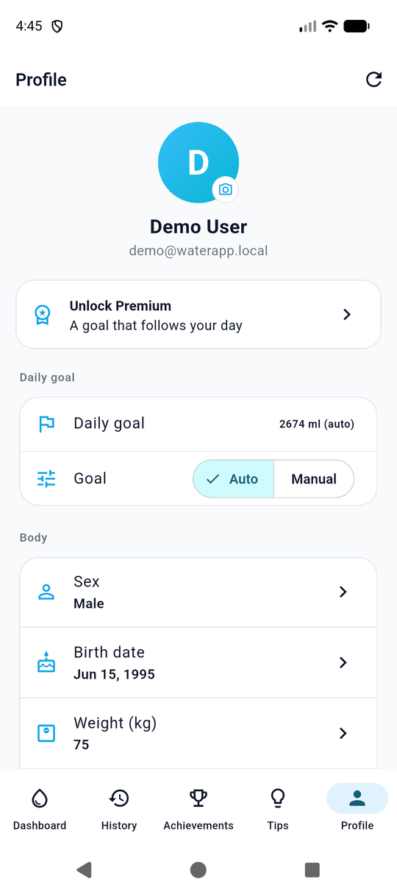 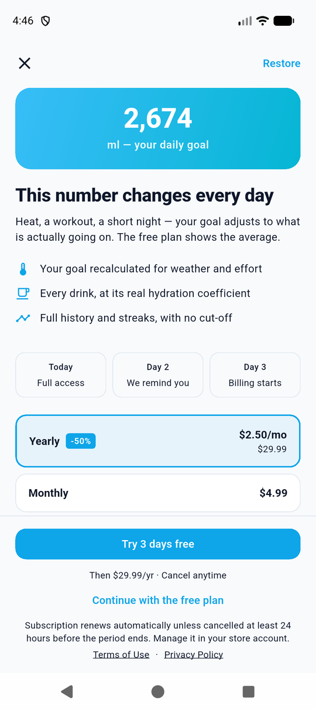 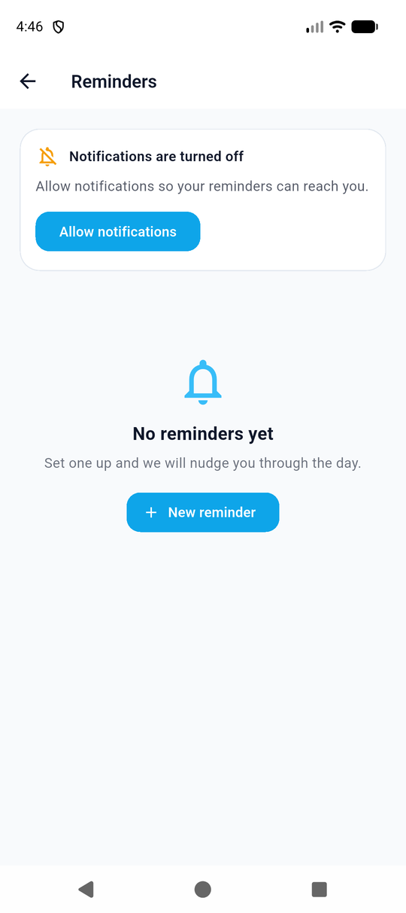

## Dark theme

Follows the system setting by default; the Profile tab has a manual
light / system / dark switch.

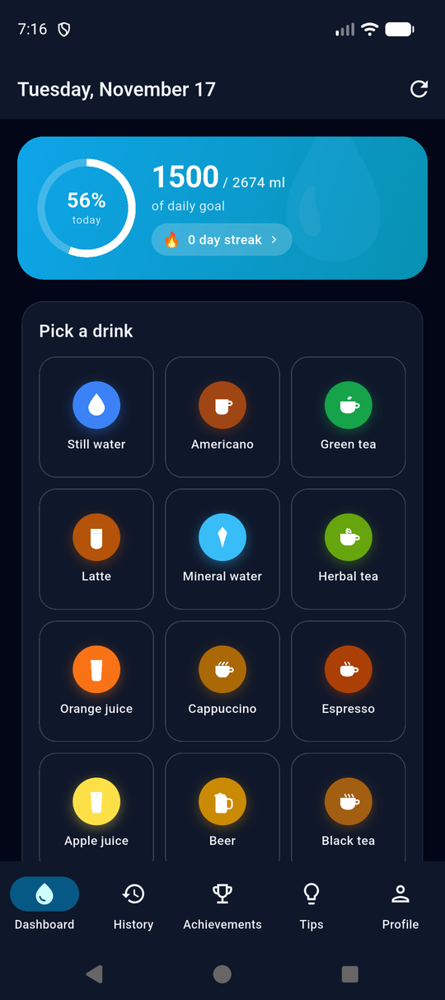 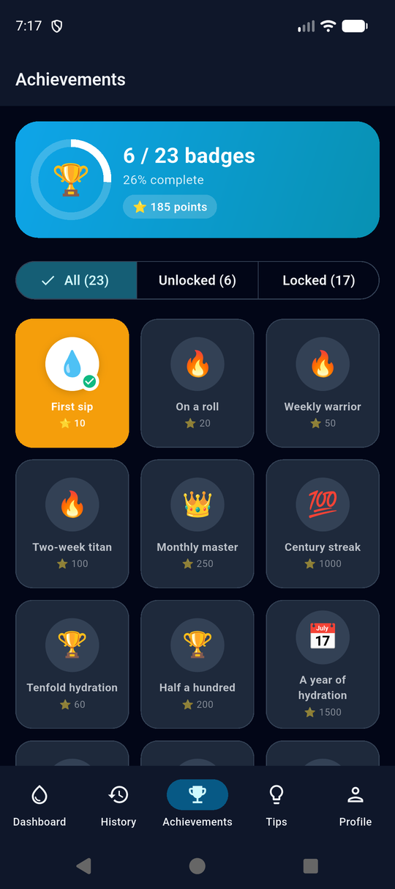

---

*Screenshots are not auto-generated. Retake them after any visual change.*
